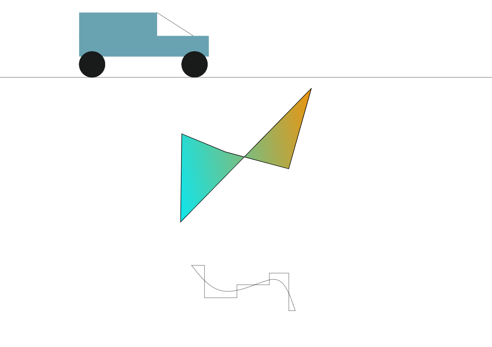

# Assignment 1: Hello World, GitHub and D3

## Project overview

This page uses D3.js to draw a simple car, a horizontal line, two curved lines, and a polygon. The polygon is mapped from sample x/y data and filled with a left-to-right orange-to-cyan gradient.

## Preview

## GitHub Pages

[View the live page](https://cjmcnally.github.io/a1-cjmcnally-colin-mcnally/)

## Technical achievements

- Made the SVG responsive, so it scales to the available page objects
- Built the car from rectangles, circles, and lines, grouped its parts, and animated the group moving linearly to the right
- Drew smooth and step-style curves from some sample data I created
- Scaled the sample data into SVG coordinates to draw a polygon, filled it with an SVG linear gradient, and animated a 360 degree rotation that lasts 5 seconds.

## Design achievements

- Used blue-green bodywork and dark wheels to make the car recognizable from simple geometric shapes.
- Used a horizontal line across the page, with the polygon centered above the two curved lines.
- Contrasted the polygon's warm orange and cool cyan gradient with the black outlines and linework.

## Sources and acknowledgments

- [D3 transform interpolation](https://d3js.org/d3-interpolate/transform) — reference for SVG transform behavior.
- [D3 Graph Gallery: Shapes](https://d3-graph-gallery.com/graph/shape.html) — shape examples used as references.
- [Stack Overflow: Drawing polygon data in D3](https://stackoverflow.com/questions/13204562/proper-format-for-drawing-polygon-data-in-d3) — reference for formatting polygon points.
- [TutorialsTeacher: Animation with D3.js](https://www.tutorialsteacher.com/d3js/animation-with-d3js) — reference for D3 animation.
- [Stack Overflow: Filling an area with a gradient](https://stackoverflow.com/questions/35833781/d3-filling-an-area-with-a-gradient) — reference for SVG gradient fills.
- GitHub Copilot was used to help debug the polygon rotation and make this README look nice.
